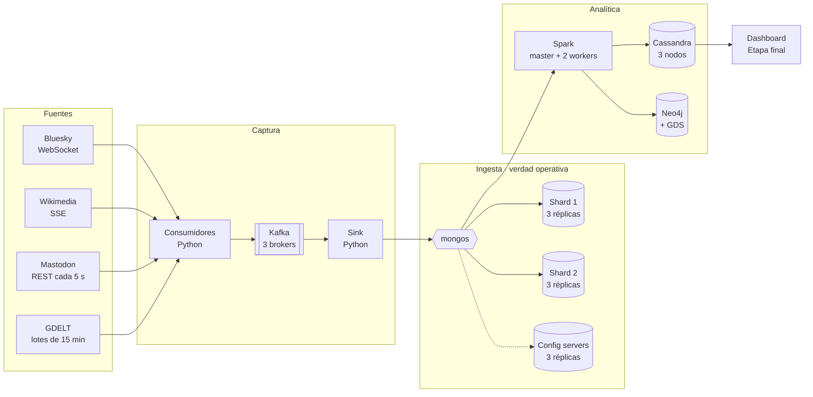

# TruthWatch

**Observación de actividad informativa para detectar posibles campañas de manipulación.**

Proyecto final de **Bases de Datos No Relacionales - Otoño 2026**.

TruthWatch conecta la conversación pública en **Bluesky** y **Mastodon** con la actividad editorial de **Wikipedia** y la cobertura de medios de **GDELT** para identificar coincidencias, cambios bruscos y patrones que merezcan revisión humana.

## Contenido

1. [Estado del proyecto](#estado-del-proyecto)
2. [Equipo y organización](#equipo-y-organización)
3. [Selección de los streams](#selección-de-los-streams)
4. [Enlaces a APIs y documentación](#enlaces-a-apis-y-documentación)
5. [Stream 1 · Bluesky Jetstream](#stream-1--bluesky-jetstream)
6. [Stream 2 · Wikimedia Recent Changes](#stream-2--wikimedia-recent-changes)
7. [Stream 3 · Mastodon](#stream-3--mastodon)
8. [Stream 4 · GDELT](#stream-4--gdelt)
9. [Consideraciones éticas](#consideraciones-éticas)
10. [Arquitectura](#arquitectura)
11. [Justificación CAP](#justificación-cap)
12. [Control de accesos](#control-de-accesos)
13. [Despliegue](#despliegue)
14. [Pruebas de la infraestructura](#pruebas-de-la-infraestructura)
15. [Limitaciones](#limitaciones)
16. [Preguntas de análisis](#preguntas-de-análisis)

## Estado del proyecto

| Etapa | Descripción | Estado |
| --- | --- | --- |
| 1 | Selección del stream de datos | **Entregada** |
| 2 | Infraestructura y configuración | **Entregada** |
| 3 | Implementación de la capa de ingesta | En curso (consumidores funcionando) |
| 4 | Capa de procesamiento para analíticos | Pendiente |
| 5 | Análisis de resultados | Pendiente |

## Equipo y organización

El proyecto vive en la organización de GitHub [`E6-BDNR`](https://github.com/E6-BDNR), que incluye a los integrantes del equipo.

| Integrante | GitHub |
| --- | --- |
| Mariana Aguayo | [@aguayo-0107](https://github.com/aguayo-0107) |
| Shagiel López | [@shagiel-lopez](https://github.com/shagiel-lopez) |
| Santiago Gatica | [@gaticadesS](https://github.com/gaticadesS) |

## Selección de los streams

Combinamos cuatro fuentes públicas y reales. Bluesky y Wikimedia cumplen los requisitos del curso por sí solas y son el centro del proyecto. Mastodon agrega una segunda red social, para ver si una narrativa aparece en dos plataformas a la vez, y GDELT da el contexto de noticias, para distinguir una anomalía de una noticia real.

| Requisito | Bluesky Jetstream | Wikimedia Recent Changes | Mastodon | GDELT |
| --- | --- | --- | --- | --- |
| Datos reales | Publicaciones de usuarios de Bluesky | Cambios en wikis de Wikimedia | Publicaciones del timeline federado de 4 instancias | Eventos extraídos de noticias de todo el mundo |
| Eventos/s (medido en ingesta, 10 min) | **≈ 38** | **≈ 31** | **≈ 2.8** | ≈ 0.6 en promedio, en lotes cada 15 min |
| Atributos por evento | 12–19 | 31–35 | ≈ 60 | 61 |
| Interés para el equipo | Conversación pública y difusión de narrativas | Disputa y evolución del conocimiento enciclopédico | Conversación en una red federada distinta | Cobertura de medios como línea base |

## Enlaces a APIs y documentación

**Bluesky · Jetstream**

- Endpoint utilizado: `wss://jetstream2.us-east.bsky.network/subscribe?wantedCollections=app.bsky.feed.post`
- [Repositorio y documentación de Jetstream](https://github.com/bluesky-social/jetstream)
- [Documentación de Jetstream (README)](https://github.com/bluesky-social/jetstream/blob/main/docs/README.md)
- [Lexicon `app.bsky.feed.post`](https://github.com/bluesky-social/atproto/blob/main/lexicons/app/bsky/feed/post.json)
- [Documentación del AT Protocol](https://atproto.com/)
- [Bluesky Playground](https://playground.bsky.guide/)

**Wikimedia · Recent Changes**

- Endpoint utilizado: `https://stream.wikimedia.org/v2/stream/recentchange`
- [Documentación de Wikimedia EventStreams](https://wikitech.wikimedia.org/wiki/Event_Platform/EventStreams_HTTP_Service)
- [Esquema `mediawiki/recentchange`](https://github.com/wikimedia/mediawiki-event-schemas/blob/master/jsonschema/mediawiki/recentchange/current.yaml)
- [Manual de la tabla `recentchanges` de MediaWiki](https://www.mediawiki.org/wiki/Manual:Recentchanges_table)
- [Visualización en vivo (Hatnote)](http://listen.hatnote.com/)

**Mastodon**

- Endpoint utilizado: `https://{instancia}/api/v1/timelines/public` en `mas.to`, `mastodon.world`, `social.vivaldi.net` y `universeodon.com`
- [API de timelines](https://docs.joinmastodon.org/methods/timelines/)
- [Entidad `Status`](https://docs.joinmastodon.org/entities/Status/)
- [Entidad `Account`](https://docs.joinmastodon.org/entities/Account/)

**GDELT 2.0**

- Endpoint utilizado: `http://data.gdeltproject.org/gdeltv2/lastupdate.txt`
- [Proyecto GDELT](https://www.gdeltproject.org/)
- [Codebook de eventos 2.0](http://data.gdeltproject.org/documentation/GDELT-Event_Codebook-V2.0.pdf)
- [Manual CAMEO](http://data.gdeltproject.org/documentation/CAMEO.Manual.1.1b3.pdf)

---

## Stream 1 · Bluesky Jetstream

### Resumen

Bluesky es una red social de microblogueo construida sobre el **AT Protocol**, un protocolo abierto y federado. Toda la actividad pública de la red (publicaciones, likes, reposts, follows, cambios de perfil) se emite en un flujo llamado *firehose*. **Jetstream** es un servicio que consume ese firehose y lo reexpone como **JSON sobre WebSocket**, con filtros por colección.

Para este proyecto usaremos solo la colección `app.bsky.feed.post`. Cada evento representa la **creación, actualización o borrado de una publicación**, e incluye su texto, idioma, fecha, menciones, enlaces, hashtags, respuestas, citas y archivos multimedia. Además, Jetstream emite eventos de **identidad** (cambio de *handle*) y de **cuenta** (activación, desactivación o suspensión).

### Origen y autoría

- **Contenido:** Lo escriben los usuarios de Bluesky. Cada cuenta guarda sus datos en un *Personal Data Server* (PDS), que puede ser de Bluesky o de terceros.
- **Agregación:** los *relays* del AT Protocol recolectan los cambios de todos los PDS y producen el firehose.
- **Servicio Jetstream:** desarrollado y operado por **Bluesky Social, PBC**, que publica instancias públicas (`jetstream1/2.us-east`, `us-west`) y el código fuente bajo licencia abierta.

### Diccionario de datos

Rutas expresadas en notación de puntos sobre el JSON recibido. Los atributos marcados con (opcional) no aparecen en todos los eventos.

**Todos los eventos**

| Atributo | Tipo | Descripción |
| --- | --- | --- |
| `did` | string | Identificador descentralizado (DID) de la cuenta que generó el evento, p. ej. `did:plc:…`. Es estable aunque cambie el *handle*. |
| `time_us` | int | Marca de tiempo en **microsegundos Unix** en la que Jetstream procesó el evento. También funciona como cursor para reanudar la conexión. |
| `kind` | string | Tipo de evento: `commit` (cambio en un registro), `identity` o `account`. |

**Evento `commit`**

| Atributo | Tipo | Descripción |
| --- | --- | --- |
| `commit.rev` | string | Revisión del repositorio del usuario tras el cambio (TID ordenable en el tiempo). |
| `commit.operation` | string | Operación: `create`, `update` o `delete`. |
| `commit.collection` | string | Colección (NSID) del registro; aquí siempre `app.bsky.feed.post`. |
| `commit.rkey` | string | Clave del registro dentro de la colección. `at://{did}/{collection}/{rkey}` identifica la publicación de forma única. |
| `commit.cid` (opcional) | string | Hash de contenido (CID) del registro. Ausente en `delete`. |
| `commit.record` (opcional) | object | Contenido de la publicación. No está presente en `delete`. |

**Registro `app.bsky.feed.post` (`commit.record.*`)**

| Atributo | Tipo | Descripción |
| --- | --- | --- |
| `$type` | string | Tipo de registro, `app.bsky.feed.post`. |
| `text` | string | Texto de la publicación (hasta 300 grafemas). |
| `createdAt` | string (ISO 8601) | Fecha de creación **declarada por el cliente**; puede diferir de `time_us`. |
| `langs` (opcional) | string[] | Idiomas declarados (BCP-47), p. ej. `["es"]`. Presente en ≈ 78 % de la muestra. |
| `facets` (opcional) | object[] | Anotaciones sobre rangos de bytes del texto: menciones (`#mention` con DID), enlaces (`#link` con URI) y hashtags (`#tag`). |
| `reply.root.uri` / `reply.root.cid` (opcional) | string | Publicación raíz del hilo, si es una respuesta. |
| `reply.parent.uri` / `reply.parent.cid` (opcional) | string | Publicación a la que responde directamente. |
| `embed.$type` (opcional) | string | Tipo de contenido incrustado: `images`, `external` (tarjeta de enlace), `record` (cita), `recordWithMedia` o `video`. |
| `embed.images[]` (opcional) | object[] | Imágenes con texto alternativo (`alt`), proporción (`aspectRatio.width/height`) y referencia al blob (`mimeType`, `size`). |
| `embed.external.uri/title/description` (opcional) | string | URL, título y descripción de la tarjeta de enlace. |
| `embed.record.uri/cid` (opcional) | string | Publicación citada. |
| `embed.video.*` (opcional) | object | Video: `mimeType`, `size` en bytes y proporción. |
| `labels.values[]` (opcional) | object[] | Etiquetas de autoclasificación (p. ej. contenido sensible) puestas por el autor. |
| `tags` (opcional) | string[] | Hashtags adicionales que no aparecen en el texto. |

**Eventos `identity` y `account`**

| Atributo | Tipo | Descripción |
| --- | --- | --- |
| `identity.did` | string | DID cuya identidad cambió. |
| `identity.handle` (opcional) | string | Nuevo *handle* (p. ej. `usuario.bsky.social`). |
| `identity.seq` | int | Número de secuencia del evento en el relay. |
| `identity.time` | string | Momento del cambio. |
| `account.active` | bool | Indica si la cuenta está activa. |
| `account.status` (opcional) | string | Motivo de inactividad: `takendown`, `suspended`, `deleted` o `deactivated`. |
| `account.did`, `account.seq`, `account.time` | string / int / string | Igual que en `identity`. |

### Clasificación de variables

| Categoría | Atributos |
| --- | --- |
| **Cuantitativas** | `time_us`, `identity.seq` / `account.seq`, `embed.*.size` (bytes), `aspectRatio.width/height`, `facets[].index.byteStart/byteEnd`. Derivadas: longitud del texto, número de menciones, enlaces, hashtags e imágenes. |
| **Cualitativas** | `kind`, `commit.operation`, `commit.collection`, `$type`, `embed.$type`, `langs`, `labels.values`, `account.active`, `account.status`, hashtags (`#tag`) y dominios de los enlaces. Identificadores (`did`, `rkey`, `cid`, `uri`) son nominales: sirven para unir registros, no para agregar. |
| **Texto no estructurado** | `record.text` (cuerpo principal), `embed.images[].alt`, `embed.external.title` y `embed.external.description`. |
| **Series temporales** | `time_us` (tiempo de procesamiento), `record.createdAt` (tiempo declarado por el autor), `commit.rev` (TID ordenable), `identity.time` / `account.time`. |

---

## Stream 2 · Wikimedia Recent Changes

### Resumen

**EventStreams** es un servicio de la Wikimedia Foundation que expone, mediante **Server-Sent Events (SSE)**, los eventos internos de sus plataformas. El stream `recentchange` emite **cada cambio realizado en cualquiera de los cientos de wikis de Wikimedia**: Wikipedia en todos los idiomas, Wikidata, Wikimedia Commons, Wiktionary, entre otras.

Cada evento describe un cambio: qué página se modificó, quién lo hizo, si fue un bot, el comentario de edición, el tamaño antes y después y los identificadores de revisión. Hay cinco tipos: `edit` (edición), `new` (página nueva), `log` (acciones administrativas como bloqueos, borrados o protecciones), `categorize` (cambio de categoría) y `external`.

### Origen y autoría

- **Contenido:** lo producen los **editores voluntarios** de los proyectos Wikimedia (usuarios registrados, cuentas temporales y bots).
- **Recolección y publicación:** la **Wikimedia Foundation**. MediaWiki registra cada cambio, lo envía a Apache Kafka a través de la *Event Platform* y EventStreams lo expone públicamente. El esquema es mantenido por la Fundación en el repositorio `mediawiki-event-schemas`.

### Diccionario de datos

Los atributos marcados con (opcional) solo aparecen en algunos tipos de evento.

**Metadatos del evento (`meta.*`)**

| Atributo | Tipo | Descripción |
| --- | --- | --- |
| `$schema` | string | Versión del esquema, p. ej. `/mediawiki/recentchange/1.0.0`. |
| `meta.id` | string (UUID) | Identificador único del evento. |
| `meta.dt` | string | Fecha y hora del evento en UTC. |
| `meta.uri` | string | URL de la página afectada. |
| `meta.domain` | string | Dominio de la wiki, p. ej. `es.wikipedia.org`. |
| `meta.stream` | string | Nombre del stream, `mediawiki.recentchange`. |
| `meta.topic` | string | Tópico de Kafka de origen, p. ej. `eqiad.mediawiki.recentchange`. |
| `meta.partition` / `meta.offset` | int | Partición y desplazamiento en Kafka; permiten reanudar el consumo sin perder eventos. |
| `meta.request_id` | string (UUID) | Identificador de la petición HTTP que originó el cambio. |

**Cambio**

| Atributo | Tipo | Descripción |
| --- | --- | --- |
| `id` (opcional) | int | Identificador del cambio en la tabla `recentchanges` de esa wiki. |
| `type` | string | `edit`, `new`, `log`, `categorize` o `external`. |
| `namespace` | int | Espacio de nombres: `0` artículo, `1` discusión, `2` usuario, `4` proyecto, `6` archivo, `14` categoría, etc. |
| `title` | string | Título de la página, con prefijo de espacio de nombres. |
| `title_url` | string | URL canónica de la página. |
| `comment` | string | Resumen de edición escrito por el editor (wikitexto). |
| `parsedcomment` | string | El mismo comentario convertido a HTML. |
| `timestamp` | int | Marca de tiempo **Unix en segundos** del cambio. |
| `user` | string | Nombre de usuario, cuenta temporal (`~2026-…`) o dirección IP del editor. |
| `bot` | bool | Indica si la cuenta tiene el permiso de bot. |
| `minor` (opcional) | bool | Edición marcada como menor. Solo en `edit` y `new`. |
| `patrolled` (opcional) | bool | Indica si el cambio fue revisado por un patrullero. Solo en wikis con patrullaje habilitado. |
| `length.old` / `length.new` (opcional) | int | Tamaño de la página en bytes antes y después. Solo en `edit` y `new`. |
| `revision.old` / `revision.new` (opcional) | int | Identificadores de la revisión anterior y la nueva. Solo en `edit` y `new`. |
| `notify_url` (opcional) | string | URL del *diff* del cambio. |
| `server_url`, `server_name`, `server_script_path` | string | Datos del servidor de la wiki. |
| `wiki` | string | Identificador de la base de datos de la wiki, p. ej. `eswiki`, `enwiki`, `wikidatawiki`. |

**Eventos `log` (opcionales)**

| Atributo | Tipo | Descripción |
| --- | --- | --- |
| `log_id` | int | Identificador de la entrada de registro. |
| `log_type` | string | Tipo de registro: `block`, `delete`, `protect`, `move`, `upload`, `newusers`, `abusefilter`, etc. |
| `log_action` | string | Acción específica dentro del tipo, p. ej. `delete`, `restore`, `create`. |
| `log_params` | object/array | Parámetros de la acción (duración de un bloqueo, página destino de un traslado, etc.). |
| `log_action_comment` | string | Descripción textual de la acción. |

### Clasificación de variables

| Categoría | Atributos |
| --- | --- |
| **Cuantitativas** | `length.old`, `length.new` y su diferencia derivada (bytes añadidos o eliminados), `timestamp`, `meta.offset`. Derivadas: ediciones por minuto, editores distintos por artículo. Los identificadores numéricos (`id`, `revision.*`, `log_id`, `namespace`) son nominales aunque sean enteros. |
| **Cualitativas** | `type`, `namespace`, `wiki`, `meta.domain`, `bot`, `minor`, `patrolled`, `log_type`, `log_action`, `user`, `title`. |
| **Texto no estructurado** | `comment`, `parsedcomment` y `log_action_comment`. En ellos aparecen indicios de reversiones (p. ej. «Revertidos los cambios de…», «Undid revision…»). |
| **Series temporales** | `meta.dt` y `timestamp` (segundos Unix); `revision.new` crece de forma monótona dentro de cada wiki. |

---

## Stream 3 · Mastodon

### Resumen

Mastodon es una red social federada: miles de servidores independientes (*instancias*) que intercambian publicaciones con el protocolo ActivityPub. Cada instancia expone un **timeline federado** con las publicaciones públicas que conoce, tanto de sus usuarios como de otras instancias.

Consultamos cada 5 segundos el timeline federado de cuatro instancias grandes que lo tienen abierto. Cada evento es una publicación (*status*) con su texto, idioma, autor, menciones, hashtags, archivos, encuestas y contadores de interacción. Una misma publicación puede llegar por varias instancias; se identifica por su `uri`, que es global.

### Origen y autoría

- **Contenido:** lo escriben los usuarios de cada instancia.
- **Publicación:** cada instancia es operada por un administrador o una organización distinta (por ejemplo, Vivaldi Technologies opera `social.vivaldi.net`). El software y la API los mantiene Mastodon gGmbH.

### Diccionario de datos

Guardamos la respuesta completa de la API dentro de `data.status`, más la instancia de donde vino en `data.instance`.

| Atributo | Tipo | Descripción |
| --- | --- | --- |
| `id` | string | Identificador local del post en la instancia que lo reporta. |
| `uri` | string | Identificador global (ActivityPub) del post. |
| `url` | string | Enlace público al post. |
| `created_at` | string (ISO 8601) | Fecha de publicación. |
| `edited_at` (opcional) | string | Fecha de la última edición. |
| `content` | string (HTML) | Texto del post. |
| `spoiler_text` | string | Advertencia de contenido escrita por el autor. |
| `sensitive` | bool | Marcado como sensible por el autor. |
| `visibility` | string | `public`, `unlisted`, `private` o `direct`; aquí siempre `public`. |
| `language` (opcional) | string | Idioma declarado (ISO 639-1). |
| `in_reply_to_id` / `in_reply_to_account_id` (opcional) | string | Post y cuenta a los que responde. |
| `replies_count`, `reblogs_count`, `favourites_count` | int | Respuestas, reblogs y favoritos al momento de la consulta. |
| `account.*` | object | Autor: `acct`, `display_name`, `bot`, `created_at`, `followers_count`, `following_count`, `statuses_count`, `note`, etc. |
| `mentions[]` | object[] | Cuentas mencionadas. |
| `tags[]` | object[] | Hashtags (`name`, `url`). |
| `media_attachments[]` | object[] | Imágenes, video o audio con `type`, `url` y `description` (texto alternativo). |
| `card` (opcional) | object | Vista previa de enlace: `url`, `title`, `description`, `provider_name`. |
| `poll` (opcional) | object | Encuesta con opciones y votos. |
| `reblog` (opcional) | object | Post original cuando el evento es un reblog. |

### Clasificación de variables

| Categoría | Atributos |
| --- | --- |
| **Cuantitativas** | `replies_count`, `reblogs_count`, `favourites_count`, `account.followers_count`, `account.following_count`, `account.statuses_count`. Derivadas: longitud del texto, número de menciones, hashtags y archivos. |
| **Cualitativas** | `visibility`, `language`, `sensitive`, `account.bot`, instancia de origen, hashtags, dominio de `card.url`. `id`, `uri` y `account.id` son nominales. |
| **Texto no estructurado** | `content`, `spoiler_text`, `account.note`, `card.title`, `card.description`, `media_attachments[].description`. |
| **Series temporales** | `created_at`, `edited_at`, `account.created_at`, `account.last_status_at`. |

---

## Stream 4 · GDELT

### Resumen

GDELT (*Global Database of Events, Language, and Tone*) monitorea noticias de radio, prensa y web en más de 100 idiomas y extrae de ellas **eventos**: quién hizo qué a quién, dónde y con qué tono. Cada 15 minutos publica un archivo nuevo con los eventos detectados en ese intervalo, codificados con la taxonomía CAMEO.

No es un stream continuo sino una serie de micro-lotes. Lo usamos como **línea base de noticias**: si un pico en Bluesky o Wikipedia coincide con muchos eventos de GDELT sobre el mismo tema, probablemente se explica por una noticia real y no por actividad coordinada.

### Origen y autoría

- **Proyecto:** The GDELT Project, creado por Kalev H. Leetaru, con apoyo de Google Jigsaw.
- **Contenido:** se genera automáticamente a partir de artículos de medios de comunicación; cada evento incluye la URL de la nota de origen.

### Diccionario de datos

El archivo es un CSV de 61 columnas sin encabezado; el consumidor les asigna nombre según el codebook. Los atributos de actor se repiten para `Actor1` y `Actor2`, y los geográficos para `Actor1Geo`, `Actor2Geo` y `ActionGeo`.

| Atributo | Tipo | Descripción |
| --- | --- | --- |
| `GLOBALEVENTID` | int | Identificador único del evento. |
| `SQLDATE`, `MonthYear`, `Year`, `FractionDate` | int / float | Fecha del evento en distintos formatos. |
| `DATEADDED` | int | Momento (UTC, `YYYYMMDDHHMMSS`) en que GDELT agregó el evento. |
| `Actor*Code`, `Actor*Name` | string | Código CAMEO y nombre del actor. |
| `Actor*CountryCode`, `Actor*KnownGroupCode`, `Actor*EthnicCode` | string | País, grupo conocido y etnia del actor. |
| `Actor*Religion1Code`, `Actor*Religion2Code` | string | Afiliación religiosa. |
| `Actor*Type1Code` … `Type3Code` | string | Tipo de actor (gobierno, militar, medios, etc.). |
| `IsRootEvent` | int | 1 si el evento aparece al inicio de la nota. |
| `EventCode`, `EventBaseCode`, `EventRootCode` | string | Acción CAMEO en tres niveles de detalle. |
| `QuadClass` | int | 1 cooperación verbal, 2 cooperación material, 3 conflicto verbal, 4 conflicto material. |
| `GoldsteinScale` | float | Impacto teórico en la estabilidad de un país (−10 a +10). |
| `NumMentions`, `NumSources`, `NumArticles` | int | Menciones, fuentes y artículos que reportan el evento. |
| `AvgTone` | float | Tono promedio de los artículos (−100 a +100). |
| `*Geo_Type`, `*Geo_FullName`, `*Geo_CountryCode`, `*Geo_ADM1Code`, `*Geo_ADM2Code` | int / string | Ubicación del actor o de la acción. |
| `*Geo_Lat`, `*Geo_Long`, `*Geo_FeatureID` | float / string | Coordenadas e identificador del lugar. |
| `SOURCEURL` | string | URL de la primera nota que reportó el evento. |

### Clasificación de variables

| Categoría | Atributos |
| --- | --- |
| **Cuantitativas** | `GoldsteinScale`, `NumMentions`, `NumSources`, `NumArticles`, `AvgTone`, `*Geo_Lat`, `*Geo_Long`. |
| **Cualitativas** | Códigos de actor, país, grupo, etnia, religión y tipo; `EventCode` y sus niveles; `QuadClass`; `IsRootEvent`; `*Geo_Type`. |
| **Texto no estructurado** | `Actor*Name`, `*Geo_FullName` y la nota enlazada en `SOURCEURL`. |
| **Series temporales** | `SQLDATE`, `MonthYear`, `Year`, `FractionDate`, `DATEADDED`. |

---

## Consideraciones éticas

**Datos personales y privacidad**

- Los dos streams son públicos, pero contienen identificadores de personas: *handles* en Bluesky, nombres de usuario y, en algunas ediciones anónimas, **direcciones IP** en Wikimedia.
- Para reducir riesgos se aplicará **minimización de datos**: en la capa analítica, los identificadores de usuario se seudonimizarán (hash con sal) y solo se conservarán los atributos necesarios para las preguntas de análisis.

**Derecho al olvido**

- Jetstream emite eventos `delete` cuando un usuario borra una publicación, y eventos `account` cuando una cuenta se desactiva o es suspendida. **Respetaremos esos borrados**: no conservaremos ninguna parte del contenido de publicaciones que su autor eliminó.
- Mastodon solo avisa de los borrados por streaming con una cuenta en cada instancia, y la consulta pública no los incluye. Como mitigación, los datos crudos de todas las fuentes **se eliminan automáticamente a los 7 días** (índice TTL en MongoDB), así que nada se conserva de forma indefinida.
- GDELT no contiene datos de personas usuarias: solo actores públicos mencionados en noticias y la URL del medio.

**Sesgos**

- **Representatividad:** los usuarios de Bluesky no representan a la población general, en su mayoría los usuarios son de habla inglesa.
- **Idioma:** las técnicas de similitud de texto funcionan peor en idiomas con menos recursos, lo que puede dejar campañas sin detectar o generar falsos positivos.
- **Bots:** gran parte de los cambios de Wikimedia fueron hechos por bots autorizados. Es importante separarlos para no confundir mantenimiento automático con actividad coordinada.
- **Atribución de intención:** una coincidencia temporal entre plataformas puede deberse a una noticia, un evento en vivo o interés legítimo. El sistema produce **alertas para revisión humana** con la evidencia que las respalda, nunca etiquetará automáticamente a personas o cuentas como manipuladoras.

**Contenido sensible y licencias**

- Las publicaciones pueden contener discurso de odio, desinformación o contenido para adultos, las etiquetas de autoclasificación (`labels`) se conservarán para filtrarlo en la presentación de resultados.
- El contenido de Wikimedia se publica bajo **CC BY-SA**, cualquier fragmento mostrado se atribuirá a su fuente. El uso de datos de Bluesky se limitará a fines académicos.

---

## Arquitectura

Toda la infraestructura corre en contenedores con Docker Compose (25 contenedores, ≈ 10 GB de RAM).



| Capa | Tecnología | Configuración | Rol |
| --- | --- | --- | --- |
| Captura | Python 3.12 | Un contenedor por fuente | Se conecta a cada fuente y reintenta con espera exponencial. Bluesky y Wikimedia retoman con cursor (`time_us`, `Last-Event-ID`). |
| Buffer | Kafka 3.9 (KRaft) | 3 brokers, 3 particiones por tópico, factor de replicación 3, `min.insync.replicas=2` | Desacopla la captura de la base de datos: si MongoDB está eligiendo primario, los eventos esperan en Kafka. |
| Ingesta y operativa | MongoDB 7.0 | 2 shards × 3 réplicas, 3 config servers, 1 `mongos` | Guarda cada evento crudo tal como llegó, una colección por fuente en la base `raw`. |
| Procesamiento (OLAP) | Spark 3.5.7 | Master + 2 workers (4 cores, 4 GB) | Limpieza, deduplicación, enriquecimiento y agregación (Etapa 4). |
| Resultados | Cassandra 5.0 | 3 nodos, factor de replicación 3 | Series de tiempo de métricas y alertas que consulta el dashboard. |
| Grafo | Neo4j 5.26 + GDS | 1 nodo | Relaciones entre cuentas, temas y artículos; comunidades y centralidad. |

**Flujo de un evento.** El consumidor envuelve el evento crudo en un documento `{_id, source, received_at, data}` y lo publica en el tópico de su fuente. El `_id` es un identificador estable del evento: `did/rkey/rev` en Bluesky, `meta.id` en Wikimedia, `uri@fecha` en Mastodon y `GLOBALEVENTID` en GDELT. El sink lee los tópicos y escribe en lotes en `raw.<fuente>`. El offset de Kafka se confirma **solo después** de que MongoDB aceptó la escritura con `w: "majority"`, y un `_id` repetido se descarta. Así, si algo falla, el mensaje se vuelve a leer y no se pierde ni se duplica.

**Sharding.** Cada colección usa una shard key **hasheada sobre `_id`**. Los identificadores de las fuentes crecen con el tiempo; con una llave por rango, todas las escrituras recientes caerían en el mismo shard. El hash las reparte de forma pareja: en la prueba quedaron 539 / 461 documentos por shard. A cambio, las consultas por rango de fecha consultan los dos shards, lo cual no es un problema porque esas consultas las hace Spark en lote.

**Por qué Spark 3.5 y no 4.x.** Los conectores oficiales de MongoDB (10.5.0), Cassandra (3.5.1) y Neo4j (5.3.6) están publicados y probados para Spark 3.5.

```
.
├── docker-compose.yml      # toda la infraestructura
├── .env.example            # variables y contraseñas (copiar a .env)
├── mongo/                  # inicialización del clúster, colecciones y usuarios
├── cassandra/              # superusuario, keyspace, tablas y roles
├── spark/                  # configuración de Spark y conectores
├── ingestion/              # consumidores de las 4 fuentes y sink a MongoDB
└── processing/             # jobs de Spark
```

## Justificación CAP

En un sistema distribuido, cuando hay una partición de red hay que elegir entre consistencia y disponibilidad. Elegimos distinto en cada capa según lo que necesita cada una.

| Componente | Prioridad | Por qué |
| --- | --- | --- |
| **MongoDB** (ingesta) | **CP** | Es la verdad operativa: no puede perder ni duplicar eventos, ni devolver un estado que después se revierta. Escribimos con `w: "majority"` y leemos del primario. Si un shard pierde a su primario, deja de aceptar escrituras durante la elección (≈ 1 s en nuestras pruebas) en lugar de arriesgar datos. |
| **Kafka** (buffer) | **CP**, compensa la disponibilidad de MongoDB | Con `acks=all` y `min.insync.replicas=2`, un mensaje solo se confirma cuando está en 2 de 3 brokers. Tolera la caída de un broker sin perder datos. Además, absorbe los segundos en que MongoDB no acepta escrituras, así que la captura nunca se detiene. |
| **Cassandra** (resultados) | **AP** | El dashboard debe responder aunque falle un nodo. Con 3 réplicas, las lecturas con consistencia `ONE` siguen funcionando con dos nodos caídos. Mostrar una métrica con unos segundos de retraso es aceptable; que el dashboard no cargue, no. La consistencia se puede ajustar por consulta (`QUORUM` cuando haga falta). |
| **Neo4j** (grafo) | No distribuido | La edición Community corre en un solo nodo. Es una capa analítica que se puede reconstruir desde Spark en cualquier momento, así que su caída no pierde información. |
| **Spark** | No aplica | Es un motor de cómputo, no de almacenamiento. Si cae un worker, el master reasigna sus tareas. |

En resumen, priorizamos consistencia donde se escribe la verdad (MongoDB y Kafka) y disponibilidad donde se lee el resultado (Cassandra). Las tres capas toleran particiones porque cada una replica sus datos en 3 nodos.

## Control de accesos

Todas las contraseñas viven en `.env`, que no se sube al repositorio; `.env.example` documenta qué variables hacen falta. Cada contenedor recibe **solo las contraseñas que usa**: los consumidores no ven ninguna, el sink solo la de `ingestor` y Spark solo las de sus usuarios. Si falta una variable, Docker Compose se niega a arrancar en lugar de usar un valor vacío. Los consumidores corren con un usuario sin privilegios (`nobody`).

Solo se publican hacia la máquina anfitriona, y únicamente en `127.0.0.1`, el router de MongoDB (27017), la consola de Spark (8080) y Neo4j (7474, 7687). Kafka, los shards, los config servers y Cassandra solo son accesibles dentro de la red interna de Docker.

**MongoDB**

- Autenticación interna entre nodos con **keyfile**; sin keyfile, un nodo no puede unirse al clúster.
- Autenticación de clientes con usuario y contraseña (SCRAM). Cada shard tiene además su propio administrador local, lo que cierra la *localhost exception*.

| Usuario | Permisos | Lo usa |
| --- | --- | --- |
| `admin` | `root` | Administración |
| `ingestor` | Rol propio `ingesta`: `find`, `insert` y `update` en `raw`. No puede borrar ni eliminar colecciones. | Sink |
| `spark` | Lectura en `raw`, lectura y escritura en `curated` | Jobs de Spark |
| `analyst` | Solo lectura en `curated` | Consultas de análisis |

**Cassandra**

- `PasswordAuthenticator` y `CassandraAuthorizer` activados.
- El usuario por defecto `cassandra` queda **sin login y sin superusuario**; se reemplaza por `admin`.
- `system_auth` se replica en los 3 nodos para que el login funcione aunque caiga uno.

| Rol | Permisos |
| --- | --- |
| `admin` | Superusuario |
| `spark_writer` | `SELECT` y `MODIFY` en el keyspace `truthwatch` |
| `web_reader` | Solo `SELECT` en `truthwatch` |

**Spark.** `spark.authenticate=true` con un secreto compartido (`SPARK_SECRET`). El master, los workers y cada job deben conocerlo para comunicarse.

**Neo4j.** Autenticación con contraseña. La edición Community no tiene roles, así que solo existe el usuario `neo4j`.

**Kafka.** Sin autenticación propia; está aislado en la red interna y ningún puerto se expone fuera de Docker.

## Despliegue

Requisitos: Docker con Compose y unos 12 GB de RAM asignados.

```bash
cp .env.example .env              # y cambiar cada "cambiar" por una contraseña
./mongo/init.sh                   # levanta todo e inicializa MongoDB
./cassandra/init.sh               # superusuario, keyspace, tablas y roles
```

Los dos scripts se pueden volver a correr sin romper nada. Después del primer arranque basta con `docker compose up -d`: los contenedores se reinician solos si fallan (`restart: unless-stopped`).

Para comprobar la conexión de Spark con las tres bases:

```bash
docker exec tw-spark-master /opt/spark/bin/spark-submit /jobs/check.py
```

| Servicio | Acceso local |
| --- | --- |
| MongoDB | `mongodb://<usuario>:<contraseña>@localhost:27017/?authSource=admin` |
| Spark UI | <http://localhost:8080> |
| Neo4j Browser | <http://localhost:7474> |

## Pruebas de la infraestructura

Pruebas hechas el 21 de noviembre de 2026 sobre el despliegue local.

**Permisos**

| Prueba | Resultado |
| --- | --- |
| `ingestor` inserta 1,000 documentos en `raw` | Permitido |
| `ingestor` intenta eliminar una colección | Rechazado (`not authorized`) |
| `ingestor` intenta leer `curated` | Rechazado |
| `analyst` intenta escribir en `raw` | Rechazado |
| Cliente sin credenciales consulta `raw` | Rechazado (`requires authentication`) |
| `web_reader` intenta truncar una tabla de Cassandra | Rechazado (`Unauthorized`) |
| Job de Spark con un secreto incorrecto | Rechazado (fallo de autenticación SASL) |

**Distribución y alta disponibilidad**

| Prueba | Resultado |
| --- | --- |
| Reparto de 1,000 documentos entre shards | 539 en `s1`, 461 en `s2` |
| Se detiene el primario del shard `s1` | Nuevo primario en ≈ 1 s; 200 escrituras exitosas con el nodo caído; el nodo regresó y recuperó el primario en 13 s |
| Se detiene un broker de Kafka durante la captura | En los siguientes 45 s entraron 3,708 eventos a MongoDB sin errores en el sink |
| Réplicas de un tópico | 3 particiones, réplicas `1,2,3`, todas en sincronía |

**Flujo completo.** `processing/check.py` lee las ediciones de Wikimedia desde MongoDB con el usuario `spark`, calcula las 5 wikis con más actividad en los workers y escribe el resultado en Cassandra (como `spark_writer`) y en Neo4j.

## Limitaciones

- **Una sola máquina física.** Las réplicas protegen contra la caída de procesos o nodos, no contra el apagado del equipo. Las pruebas de fallo se hacen a nivel de contenedor. El despliegue de referencia corre en una laptop que no está encendida 24/7, así que puede haber huecos en la captura.
- **Mastodon sin borrados.** Ver [Consideraciones éticas](#consideraciones-éticas); se mitiga con el TTL de 7 días.
- **GDELT llega por lotes** cada 15 minutos, no evento por evento.
- **Neo4j Community** no tiene alta disponibilidad ni roles.
- **Kafka sin autenticación**, protegido solo por el aislamiento de red.
- **Sin TLS.** Las conexiones no van cifradas: todo corre en la red interna de Docker o en `127.0.0.1`. Habría que agregarlo antes de exponer cualquier servicio.
- **Interfaz de Spark sin login.** El puerto 8080 solo se abre en `127.0.0.1`.
- **Espacio en disco.** Con el TTL de 7 días, el oplog limitado a 2 GB por nodo y Kafka con 24 h de retención, el proyecto se estabiliza en unos 120 GB.
- **Cursores en memoria.** Si un consumidor se reinicia, Bluesky y Wikimedia retoman desde el momento actual; persistir el cursor queda para la Etapa 3.

## Preguntas de análisis

1. ¿Qué narrativas registran aumentos extraordinarios de publicaciones?
2. ¿Existen grupos de publicaciones similares realizadas en intervalos muy cortos?
3. ¿Qué artículos presentan picos de ediciones y posibles reversiones?
4. ¿Coinciden temporalmente las anomalías de Bluesky y Wikipedia?
5. ¿Qué temas y patrones merecen una alerta para revisión humana?
