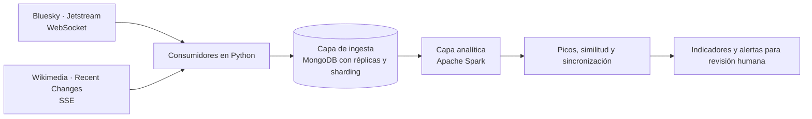

# TruthWatch

**Observación de actividad informativa para detectar posibles campañas de manipulación.**

Proyecto final de **Bases de Datos No Relacionales - Otoño 2026**.

TruthWatch conecta la conversación pública en **Bluesky** con la actividad editorial de **Wikipedia** para identificar coincidencias, cambios bruscos y patrones que merezcan revisión humana.

## Contenido

1. [Estado del proyecto](#estado-del-proyecto)
2. [Equipo y organización](#equipo-y-organización)
3. [Selección de los streams](#selección-de-los-streams)
4. [Enlaces a APIs y documentación](#enlaces-a-apis-y-documentación)
5. [Stream 1 · Bluesky Jetstream](#stream-1--bluesky-jetstream)
6. [Stream 2 · Wikimedia Recent Changes](#stream-2--wikimedia-recent-changes)
7. [Consideraciones éticas](#consideraciones-éticas)
8. [Arquitectura propuesta](#arquitectura-propuesta)
9. [Preguntas de análisis](#preguntas-de-análisis)

## Estado del proyecto

| Etapa | Descripción | Estado |
| --- | --- | --- |
| 1 | Selección del stream de datos | **Entregada** |
| 2 | Infraestructura y configuración | Pendiente |
| 3 | Implementación de la capa de ingesta | Pendiente |
| 4 | Capa de procesamiento para analíticos | Pendiente |
| 5 | Análisis de resultados | Pendiente |

## Equipo y organización

El proyecto vive en la organización de GitHub [`E6-BDNR`](https://github.com/E6-BDNR), que incluye a los integrantes del equipo.

| Integrante | GitHub |
| --- | --- |
| Mariana Aguayo | [@aguayo-0107](https://github.com/aguayo-0107) |
| Shagiel López | [@shagiel-lopez](https://github.com/shagiel-lopez) |
| Santiago Gatica | [@gaticadesS](https://github.com/gaticadesS) |

## Selección de los streams

Combinamos dos streams públicos y reales. Ambos cumplen los requisitos del curso de forma individual, pero los usamos en conjunto porque la pregunta de nuestro proyecto exige observar las dos plataformas al mismo tiempo.

| Requisito | Bluesky Jetstream | Wikimedia Recent Changes |
| --- | --- | --- |
| Datos reales | Publicaciones reales de usuarios de Bluesky | Cambios reales en wikis de Wikimedia |
| ≥ 1 evento/s en promedio | **≈ 52 eventos/s** (1,039 eventos en 20 s) | **≈ 21 eventos/s** (423 eventos en 20 s) |
| ≥ 10 atributos por evento | 12 atributos en una publicación de texto simple; más con respuestas, enlaces o imágenes | 31 atributos en un evento `edit` típico |
| Interés para el equipo | Conversación pública y difusión de narrativas | Disputa y evolución del conocimiento enciclopédico |

## Enlaces a APIs y documentación

**Bluesky · Jetstream**

- Endpoint utilizado: `wss://jetstream2.us-east.bsky.network/subscribe?wantedCollections=app.bsky.feed.post`
- [Repositorio y documentación de Jetstream](https://github.com/bluesky-social/jetstream)
- [Documentación de Jetstream (README)](https://github.com/bluesky-social/jetstream/blob/main/docs/README.md)
- [Lexicon `app.bsky.feed.post`](https://github.com/bluesky-social/atproto/blob/main/lexicons/app/bsky/feed/post.json)
- [Documentación del AT Protocol](https://atproto.com/)
- [Bluesky Playground](https://playground.bsky.guide/)

**Wikimedia · Recent Changes**

- Endpoint utilizado: `https://stream.wikimedia.org/v2/stream/recentchange`
- [Documentación de Wikimedia EventStreams](https://wikitech.wikimedia.org/wiki/Event_Platform/EventStreams_HTTP_Service)
- [Esquema `mediawiki/recentchange`](https://github.com/wikimedia/mediawiki-event-schemas/blob/master/jsonschema/mediawiki/recentchange/current.yaml)
- [Manual de la tabla `recentchanges` de MediaWiki](https://www.mediawiki.org/wiki/Manual:Recentchanges_table)
- [Visualización en vivo (Hatnote)](http://listen.hatnote.com/)

---

## Stream 1 · Bluesky Jetstream

### Resumen

Bluesky es una red social de microblogueo construida sobre el **AT Protocol**, un protocolo abierto y federado. Toda la actividad pública de la red (publicaciones, likes, reposts, follows, cambios de perfil) se emite en un flujo llamado *firehose*. **Jetstream** es un servicio que consume ese firehose y lo reexpone como **JSON sobre WebSocket**, con filtros por colección.

Para este proyecto usaremos solo la colección `app.bsky.feed.post`. Cada evento representa la **creación, actualización o borrado de una publicación**, e incluye su texto, idioma, fecha, menciones, enlaces, hashtags, respuestas, citas y archivos multimedia. Además, Jetstream emite eventos de **identidad** (cambio de *handle*) y de **cuenta** (activación, desactivación o suspensión).

### Origen y autoría

- **Contenido:** Lo escriben los usuarios de Bluesky. Cada cuenta guarda sus datos en un *Personal Data Server* (PDS), que puede ser de Bluesky o de terceros.
- **Agregación:** los *relays* del AT Protocol recolectan los cambios de todos los PDS y producen el firehose.
- **Servicio Jetstream:** desarrollado y operado por **Bluesky Social, PBC**, que publica instancias públicas (`jetstream1/2.us-east`, `us-west`) y el código fuente bajo licencia abierta.

### Diccionario de datos

Rutas expresadas en notación de puntos sobre el JSON recibido. Los atributos marcados con (opcional) no aparecen en todos los eventos.

**Todos los eventos**

| Atributo | Tipo | Descripción |
| --- | --- | --- |
| `did` | string | Identificador descentralizado (DID) de la cuenta que generó el evento, p. ej. `did:plc:…`. Es estable aunque cambie el *handle*. |
| `time_us` | int | Marca de tiempo en **microsegundos Unix** en la que Jetstream procesó el evento. También funciona como cursor para reanudar la conexión. |
| `kind` | string | Tipo de evento: `commit` (cambio en un registro), `identity` o `account`. |

**Evento `commit`**

| Atributo | Tipo | Descripción |
| --- | --- | --- |
| `commit.rev` | string | Revisión del repositorio del usuario tras el cambio (TID ordenable en el tiempo). |
| `commit.operation` | string | Operación: `create`, `update` o `delete`. |
| `commit.collection` | string | Colección (NSID) del registro; aquí siempre `app.bsky.feed.post`. |
| `commit.rkey` | string | Clave del registro dentro de la colección. `at://{did}/{collection}/{rkey}` identifica la publicación de forma única. |
| `commit.cid` (opcional) | string | Hash de contenido (CID) del registro. Ausente en `delete`. |
| `commit.record` (opcional) | object | Contenido de la publicación. No está presente en `delete`. |

**Registro `app.bsky.feed.post` (`commit.record.*`)**

| Atributo | Tipo | Descripción |
| --- | --- | --- |
| `$type` | string | Tipo de registro, `app.bsky.feed.post`. |
| `text` | string | Texto de la publicación (hasta 300 grafemas). |
| `createdAt` | string (ISO 8601) | Fecha de creación **declarada por el cliente**; puede diferir de `time_us`. |
| `langs` (opcional) | string[] | Idiomas declarados (BCP-47), p. ej. `["es"]`. Presente en ≈ 78 % de la muestra. |
| `facets` (opcional) | object[] | Anotaciones sobre rangos de bytes del texto: menciones (`#mention` con DID), enlaces (`#link` con URI) y hashtags (`#tag`). |
| `reply.root.uri` / `reply.root.cid` (opcional) | string | Publicación raíz del hilo, si es una respuesta. |
| `reply.parent.uri` / `reply.parent.cid` (opcional) | string | Publicación a la que responde directamente. |
| `embed.$type` (opcional) | string | Tipo de contenido incrustado: `images`, `external` (tarjeta de enlace), `record` (cita), `recordWithMedia` o `video`. |
| `embed.images[]` (opcional) | object[] | Imágenes con texto alternativo (`alt`), proporción (`aspectRatio.width/height`) y referencia al blob (`mimeType`, `size`). |
| `embed.external.uri/title/description` (opcional) | string | URL, título y descripción de la tarjeta de enlace. |
| `embed.record.uri/cid` (opcional) | string | Publicación citada. |
| `embed.video.*` (opcional) | object | Video: `mimeType`, `size` en bytes y proporción. |
| `labels.values[]` (opcional) | object[] | Etiquetas de autoclasificación (p. ej. contenido sensible) puestas por el autor. |
| `tags` (opcional) | string[] | Hashtags adicionales que no aparecen en el texto. |

**Eventos `identity` y `account`**

| Atributo | Tipo | Descripción |
| --- | --- | --- |
| `identity.did` | string | DID cuya identidad cambió. |
| `identity.handle` (opcional) | string | Nuevo *handle* (p. ej. `usuario.bsky.social`). |
| `identity.seq` | int | Número de secuencia del evento en el relay. |
| `identity.time` | string | Momento del cambio. |
| `account.active` | bool | Indica si la cuenta está activa. |
| `account.status` (opcional) | string | Motivo de inactividad: `takendown`, `suspended`, `deleted` o `deactivated`. |
| `account.did`, `account.seq`, `account.time` | string / int / string | Igual que en `identity`. |

### Clasificación de variables

| Categoría | Atributos |
| --- | --- |
| **Cuantitativas** | `time_us`, `identity.seq` / `account.seq`, `embed.*.size` (bytes), `aspectRatio.width/height`, `facets[].index.byteStart/byteEnd`. Derivadas: longitud del texto, número de menciones, enlaces, hashtags e imágenes. |
| **Cualitativas** | `kind`, `commit.operation`, `commit.collection`, `$type`, `embed.$type`, `langs`, `labels.values`, `account.active`, `account.status`, hashtags (`#tag`) y dominios de los enlaces. Identificadores (`did`, `rkey`, `cid`, `uri`) son nominales: sirven para unir registros, no para agregar. |
| **Texto no estructurado** | `record.text` (cuerpo principal), `embed.images[].alt`, `embed.external.title` y `embed.external.description`. |
| **Series temporales** | `time_us` (tiempo de procesamiento), `record.createdAt` (tiempo declarado por el autor), `commit.rev` (TID ordenable), `identity.time` / `account.time`. |

---

## Stream 2 · Wikimedia Recent Changes

### Resumen

**EventStreams** es un servicio de la Wikimedia Foundation que expone, mediante **Server-Sent Events (SSE)**, los eventos internos de sus plataformas. El stream `recentchange` emite **cada cambio realizado en cualquiera de los cientos de wikis de Wikimedia**: Wikipedia en todos los idiomas, Wikidata, Wikimedia Commons, Wiktionary, entre otras.

Cada evento describe un cambio: qué página se modificó, quién lo hizo, si fue un bot, el comentario de edición, el tamaño antes y después y los identificadores de revisión. Hay cinco tipos: `edit` (edición), `new` (página nueva), `log` (acciones administrativas como bloqueos, borrados o protecciones), `categorize` (cambio de categoría) y `external`.

### Origen y autoría

- **Contenido:** lo producen los **editores voluntarios** de los proyectos Wikimedia (usuarios registrados, cuentas temporales y bots).
- **Recolección y publicación:** la **Wikimedia Foundation**. MediaWiki registra cada cambio, lo envía a Apache Kafka a través de la *Event Platform* y EventStreams lo expone públicamente. El esquema es mantenido por la Fundación en el repositorio `mediawiki-event-schemas`.

### Diccionario de datos

Los atributos marcados con (opcional) solo aparecen en algunos tipos de evento.

**Metadatos del evento (`meta.*`)**

| Atributo | Tipo | Descripción |
| --- | --- | --- |
| `$schema` | string | Versión del esquema, p. ej. `/mediawiki/recentchange/1.0.0`. |
| `meta.id` | string (UUID) | Identificador único del evento. |
| `meta.dt` | string | Fecha y hora del evento en UTC. |
| `meta.uri` | string | URL de la página afectada. |
| `meta.domain` | string | Dominio de la wiki, p. ej. `es.wikipedia.org`. |
| `meta.stream` | string | Nombre del stream, `mediawiki.recentchange`. |
| `meta.topic` | string | Tópico de Kafka de origen, p. ej. `eqiad.mediawiki.recentchange`. |
| `meta.partition` / `meta.offset` | int | Partición y desplazamiento en Kafka; permiten reanudar el consumo sin perder eventos. |
| `meta.request_id` | string (UUID) | Identificador de la petición HTTP que originó el cambio. |

**Cambio**

| Atributo | Tipo | Descripción |
| --- | --- | --- |
| `id` (opcional) | int | Identificador del cambio en la tabla `recentchanges` de esa wiki. |
| `type` | string | `edit`, `new`, `log`, `categorize` o `external`. |
| `namespace` | int | Espacio de nombres: `0` artículo, `1` discusión, `2` usuario, `4` proyecto, `6` archivo, `14` categoría, etc. |
| `title` | string | Título de la página, con prefijo de espacio de nombres. |
| `title_url` | string | URL canónica de la página. |
| `comment` | string | Resumen de edición escrito por el editor (wikitexto). |
| `parsedcomment` | string | El mismo comentario convertido a HTML. |
| `timestamp` | int | Marca de tiempo **Unix en segundos** del cambio. |
| `user` | string | Nombre de usuario, cuenta temporal (`~2026-…`) o dirección IP del editor. |
| `bot` | bool | Indica si la cuenta tiene el permiso de bot. |
| `minor` (opcional) | bool | Edición marcada como menor. Solo en `edit` y `new`. |
| `patrolled` (opcional) | bool | Indica si el cambio fue revisado por un patrullero. Solo en wikis con patrullaje habilitado. |
| `length.old` / `length.new` (opcional) | int | Tamaño de la página en bytes antes y después. Solo en `edit` y `new`. |
| `revision.old` / `revision.new` (opcional) | int | Identificadores de la revisión anterior y la nueva. Solo en `edit` y `new`. |
| `notify_url` (opcional) | string | URL del *diff* del cambio. |
| `server_url`, `server_name`, `server_script_path` | string | Datos del servidor de la wiki. |
| `wiki` | string | Identificador de la base de datos de la wiki, p. ej. `eswiki`, `enwiki`, `wikidatawiki`. |

**Eventos `log` (opcionales)**

| Atributo | Tipo | Descripción |
| --- | --- | --- |
| `log_id` | int | Identificador de la entrada de registro. |
| `log_type` | string | Tipo de registro: `block`, `delete`, `protect`, `move`, `upload`, `newusers`, `abusefilter`, etc. |
| `log_action` | string | Acción específica dentro del tipo, p. ej. `delete`, `restore`, `create`. |
| `log_params` | object/array | Parámetros de la acción (duración de un bloqueo, página destino de un traslado, etc.). |
| `log_action_comment` | string | Descripción textual de la acción. |

### Clasificación de variables

| Categoría | Atributos |
| --- | --- |
| **Cuantitativas** | `length.old`, `length.new` y su diferencia derivada (bytes añadidos o eliminados), `timestamp`, `meta.offset`. Derivadas: ediciones por minuto, editores distintos por artículo. Los identificadores numéricos (`id`, `revision.*`, `log_id`, `namespace`) son nominales aunque sean enteros. |
| **Cualitativas** | `type`, `namespace`, `wiki`, `meta.domain`, `bot`, `minor`, `patrolled`, `log_type`, `log_action`, `user`, `title`. |
| **Texto no estructurado** | `comment`, `parsedcomment` y `log_action_comment`. En ellos aparecen indicios de reversiones (p. ej. «Revertidos los cambios de…», «Undid revision…»). |
| **Series temporales** | `meta.dt` y `timestamp` (segundos Unix); `revision.new` crece de forma monótona dentro de cada wiki. |

---

## Consideraciones éticas

**Datos personales y privacidad**

- Los dos streams son públicos, pero contienen identificadores de personas: *handles* en Bluesky, nombres de usuario y, en algunas ediciones anónimas, **direcciones IP** en Wikimedia.
- Para reducir riesgos se aplicará **minimización de datos**: en la capa analítica, los identificadores de usuario se seudonimizarán (hash con sal) y solo se conservarán los atributos necesarios para las preguntas de análisis.

**Derecho al olvido**

- Jetstream emite eventos `delete` cuando un usuario borra una publicación, y eventos `account` cuando una cuenta se desactiva o es suspendida. **Respetaremos esos borrados**: no conservaremos ninguna parte del contenido de publicaciones que su autor eliminó.

**Sesgos**

- **Representatividad:** los usuarios de Bluesky no representan a la población general, en su mayoría los usuarios son de habla inglesa.
- **Idioma:** las técnicas de similitud de texto funcionan peor en idiomas con menos recursos, lo que puede dejar campañas sin detectar o generar falsos positivos.
- **Bots:** gran parte de los cambios de Wikimedia fueron hechos por bots autorizados. Es importante separarlos para no confundir mantenimiento automático con actividad coordinada.
- **Atribución de intención:** una coincidencia temporal entre plataformas puede deberse a una noticia, un evento en vivo o interés legítimo. El sistema produce **alertas para revisión humana** con la evidencia que las respalda, nunca etiquetará automáticamente a personas o cuentas como manipuladoras.

**Contenido sensible y licencias**

- Las publicaciones pueden contener discurso de odio, desinformación o contenido para adultos, las etiquetas de autoclasificación (`labels`) se conservarán para filtrarlo en la presentación de resultados.
- El contenido de Wikimedia se publica bajo **CC BY-SA**, cualquier fragmento mostrado se atribuirá a su fuente. El uso de datos de Bluesky se limitará a fines académicos.

---

## Arquitectura propuesta

El diseño definitivo y su justificación con el teorema CAP corresponden a la Etapa 2. La propuesta inicial es:

| Capa | Tecnología candidata | Rol |
| --- | --- | --- |
| Ingesta y operativa | **MongoDB** (replica set + sharding) | Escritura rápida de documentos JSON heterogéneos; fuente de verdad operativa. |
| Procesamiento analítico (OLAP) | **Apache Spark** | Limpieza, deduplicación, enriquecimiento y agregaciones masivas. |
| Captura | **Python** | Consumidores del WebSocket y del SSE con reanudación por cursor (`time_us` / `meta.offset`). |
| Visualización | Por definir | Prototipo de indicadores y alertas. |

## Preguntas de análisis

1. ¿Qué narrativas registran aumentos extraordinarios de publicaciones?
2. ¿Existen grupos de publicaciones similares realizadas en intervalos muy cortos?
3. ¿Qué artículos presentan picos de ediciones y posibles reversiones?
4. ¿Coinciden temporalmente las anomalías de Bluesky y Wikipedia?
5. ¿Qué temas y patrones merecen una alerta para revisión humana?
