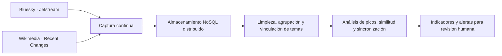

# TruthWatch

**Observatorio de actividad informativa para detectar posibles campañas de manipulación.**

Proyecto propuesto para la materia **Bases de Datos No Relacionales · Otoño 2026**.

TruthWatch busca conectar la conversación pública en Bluesky con la actividad editorial de Wikipedia para identificar coincidencias, cambios bruscos y patrones que merezcan revisión humana.

> Una anomalía no demuestra coordinación, manipulación ni falsedad. El proyecto genera señales para investigar; no emite acusaciones automáticas ni determina la veracidad de una publicación.

## Estado del proyecto

En fase de propuesta. Este repositorio contiene la documentación inicial; todavía no incluye capturadores, base de datos, procesamiento ni interfaz ejecutable. Las tecnologías y los criterios técnicos están sujetos a validación durante el desarrollo.

## Problema y objetivo

Durante una controversia, distintas cuentas pueden difundir narrativas similares mientras aumenta la actividad en artículos de Wikipedia relacionados. Esa coincidencia puede corresponder a interés espontáneo, debate público o posible coordinación.

El objetivo es reunir evidencia observable de ambas plataformas y analizar su relación temporal, sin atribuir intenciones a partir de la correlación.

## Fuentes de datos propuestas

| Fuente | Canal | Información de interés |
| --- | --- | --- |
| Bluesky · Jetstream | WebSocket seguro (WSS) | Identificadores, fecha, contenido de publicaciones, operación y metadatos disponibles. |
| Wikimedia · Recent Changes | Server-Sent Events (SSE) | Artículo, usuario, wiki, tipo de cambio, hora, comentario e identificadores de revisión. |

En Bluesky se buscarán publicaciones similares, aumentos de volumen y actividad sincronizada. En Wikipedia se estudiarán ediciones frecuentes, participación de múltiples usuarios y posibles reversiones asociadas a esos temas.

Los atributos realmente disponibles, los filtros y el caudal de cada fuente se deben comprobar con eventos de muestra. La identificación de reversiones también requiere validación técnica.

## Flujo propuesto



1. **Captura:** escuchar ambos streams y recibir los eventos relevantes.
2. **Almacenamiento:** persistir los eventos en una base NoSQL distribuida.
3. **Procesamiento:** limpiar los datos, agrupar publicaciones y vincular temas con artículos.
4. **Detección:** identificar picos, similitudes y coincidencias temporales.
5. **Visualización:** presentar indicadores y alertas con evidencia para su revisión.

## Tecnologías candidatas

| Tecnología | Uso previsto |
| --- | --- |
| Python | Captura y preparación de eventos. |
| MongoDB | Almacenamiento documental, con evaluación de replicación y sharding. |
| Apache Spark | Procesamiento y consultas analíticas. |
| Interfaz por definir | Prototipo visual de indicadores y alertas. |

La selección definitiva se justificará mediante los requisitos del curso y los resultados de las pruebas. Esta lista no representa componentes ya implementados.

## Preguntas de análisis

1. ¿Qué narrativas registran aumentos extraordinarios de publicaciones?
2. ¿Existen grupos de publicaciones similares realizadas en intervalos muy cortos?
3. ¿Qué artículos presentan picos de ediciones y posibles reversiones?
4. ¿Coinciden temporalmente las anomalías de Bluesky y Wikipedia?
5. ¿Qué temas y patrones merecen una alerta para revisión humana?

## Entregables previstos

- Pipeline de captura continua de ambas fuentes.
- Almacenamiento NoSQL distribuido.
- Consultas analíticas sobre las señales observadas.
- Prototipo visual de indicadores y alertas.
- Evidencia de las validaciones técnicas del proyecto.

## Validaciones pendientes

- [ ] Medir un caudal promedio de al menos **1 evento por segundo** en el alcance acordado.
- [ ] Verificar al menos **10 atributos por evento** en los eventos admitidos.
- [ ] Validar la vinculación entre temas de Bluesky y artículos de Wikipedia.
- [ ] Definir ventanas temporales y criterios para picos, similitud y sincronización.
- [ ] Ejecutar pruebas de carga.
- [ ] Evaluar replicación y sharding.
- [ ] Comprobar resiliencia ante fallos e interrupciones.

Estos puntos son objetivos de validación, no resultados obtenidos. Debe precisarse si los umbrales se aplican por fuente o al conjunto de eventos capturados.

## Próximos pasos

1. Revisar los requisitos del curso y delimitar los eventos que se admitirán.
2. Inspeccionar muestras de ambos streams para confirmar caudal y atributos.
3. Diseñar el modelo de datos y justificar las tecnologías elegidas.
4. Implementar la captura y el almacenamiento iniciales.
5. Desarrollar las consultas, validar sus resultados y construir el prototipo visual.

Las instrucciones de instalación y ejecución se agregarán cuando exista una primera implementación.

## Referencias

Documento base: *TruthWatch_Propuesta.pdf*, propuesta del proyecto para Otoño 2026.

Documentación y fuentes enlazadas en la propuesta:

- [Documentación de Bluesky Jetstream](https://github.com/bluesky-social/jetstream/blob/main/docs/README.md).
- [Documentación de Wikimedia EventStreams](https://wikitech.wikimedia.org/wiki/EventStreams).
- [Esquema de eventos Recent Changes](https://github.com/wikimedia/mediawiki-event-schemas/blob/master/jsonschema/mediawiki/recentchange/current.yaml).
- [Stream de Wikimedia Recent Changes](https://stream.wikimedia.org/v2/stream/recentchange).

Ejemplo de endpoint de Bluesky incluido en la propuesta:

```text
wss://jetstream2.us-east.bsky.network/subscribe?wantedCollections=app.bsky.feed.post
```
